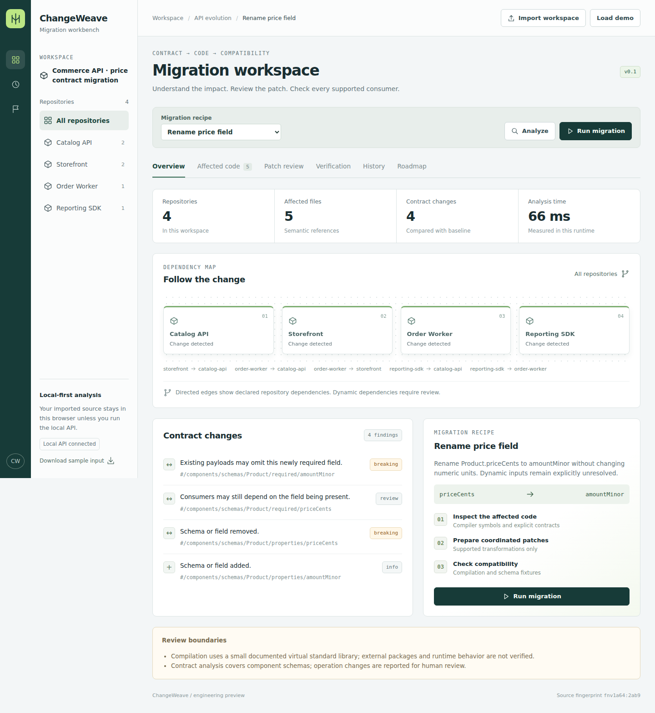
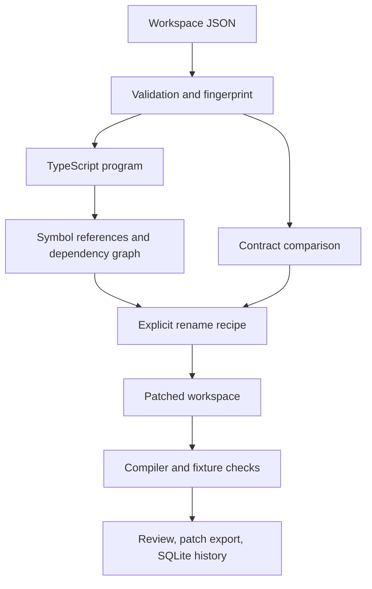

# ChangeWeave

**Understand an API change. Follow its dependencies. Review the migration.**

ChangeWeave is a local code migration workbench for connected TypeScript repositories. It uses the TypeScript compiler to distinguish references to a specific interface property from unrelated fields with the same spelling, generates reviewable patches, and checks them against explicit contract fixtures.

The included commerce workspace makes the difficult case visible: a price field is used by four repositories, but a matching analytics field must remain unchanged and an untyped payload must be flagged for review.



## Run in three commands

Requires **Node.js 24+** and npm. The compiler and browser build dependencies are pinned in `package-lock.json`.

```bash
npm ci
npm run build:web
npm start
```

Open **http://127.0.0.1:4311**. No API key or external account is required. The local server persists migration runs in `data/changeweave.sqlite`. The interface reloads saved runs into **History** when it connects to the API.

```bash
npm test
npm run demo
npm run benchmark
```

For Docker:

```bash
docker compose up --build
```

Compose publishes only to the host's loopback address and retains local run history in a named volume. See [security and deployment boundaries](SECURITY.md) before changing network exposure.

## The working core

| Capability | What v0.1 actually does |
| --- | --- |
| Workspace import | Accepts bounded JSON workspaces containing TypeScript source, dependency declarations, contracts, recipes, and payload fixtures. |
| Semantic analysis | Resolves interface field symbols, property access, string-key access, typed object construction, and destructuring through the TypeScript compiler. |
| Dependency map | Combines declared repository dependencies with resolved cross-repository imports; identifies strongly connected components. |
| Contract comparison | Reports component-schema field/type/required/constraint changes and marks operation changes for review. |
| Patch generation | Performs explicitly configured interface-property renames. It preserves unrelated symbols and keeps local destructured variable names. |
| Verification | Checks virtual TypeScript compilation, supplied before/after payload expectations, and four provider/consumer schema-fixture combinations. |
| Review handling | Records dynamic access, cycles, name collisions, unsupported business transformations, missing fixtures, and stale workspaces. |
| Optional AI review | Requests structured, review-only suggestions for unresolved files from a configured compatible endpoint. Suggestions never change patches. |
| Persistence and export | Runs migrations through the connected local API, reloads SQLite run history, and exports unified patches or the patched workspace JSON. Browser-only mode retains runs in localStorage. |

The default run is deliberately **`needs-review`**: `reporting-sdk` reads an `any` payload. Valid typed patches still appear, but the product does not silently declare that runtime access migrated safely.

## Try the migration

1. Load the commerce demo and select **Rename price field**.
2. Inspect the contract diff: `Product.priceCents` becomes `Product.amountMinor` without changing monetary units.
3. Inspect the affected source files and repository dependencies.
4. Run the migration and review generated patches.
5. Confirm that `AdBid.priceCents` and the unrelated analytics object retain their original fields.
6. Review the untyped `externalPayload` access; the tool cannot infer its runtime contract.
7. Inspect the compatibility matrix and export the patch or workspace.
8. Open **History**, reload the page, and reopen the saved run.
9. Try **Require market code** or **Introduce structured price** to see a business-rule change that requires human decisions.
10. If you configured a provider, use **Request AI review** in Patch review for separate, unverified suggestions.

The importable fixture is [`fixtures/commerce-workspace.json`](fixtures/commerce-workspace.json). The complete worked example is [here](docs/migration-walkthrough.md).

## Architecture



The core runs both in the browser bundle and through the local Node API. With the local server connected, the interface submits migrations to the API and restores saved SQLite runs on reload. Browser-only mode analyzes locally and keeps run history in localStorage; those records are not automatically imported into the server database. The source tree is intentionally small enough to inspect:

- `core/`: pure JavaScript migration logic backed by the TypeScript compiler.
- `server/`: local HTTP API, SQLite persistence, CLI demonstration, benchmark.
- `web/`: interface and bundled browser engine.
- `fixtures/`: importable commerce workspace and recorded local benchmark.
- `tests/`: semantic, validation, export, and API regression checks.

## API example

With `npm start` running:

```bash
node scripts/api-demo.mjs
```

This reads the demo from the server, analyzes it, submits a migration with the expected fingerprint, and prints the saved run ID and actual verification summary. It never edits your repositories.

| Method | Route | Purpose |
| --- | --- | --- |
| GET | `/api/demo` | Load the demo workspace. |
| GET | `/api/capabilities` | Read optional AI configuration status without secrets. |
| POST | `/api/suggest` | Request opt-in, review-only AI suggestions for a workspace/recipe. |
| POST | `/api/analyze` | Analyze `{workspace, recipeId}`. |
| POST | `/api/migrate` | Run `{workspace, recipeId, expectedFingerprint}` and save the result. |
| GET | `/api/runs` | List the latest 100 runs. |
| GET | `/api/runs/:id` | Retrieve a complete run. |
| GET | `/api/runs/:id/patches` | Download the unified patch. |
| GET | `/api/runs/:id/workspace` | Download the patched workspace. |
| GET | `/healthz` | Local health check. |

Set `PORT` (default `4311`), `HOST` (default `127.0.0.1`), or `CHANGEWEAVE_DB` to override local server settings. Patching is deterministic and compiler-backed. Optional AI review is separate from the patch engine.

To enable review suggestions, set `CHANGEWEAVE_ENABLE_LLM=1`, `LLM_MODEL`, and `LLM_API_KEY` on the server. `LLM_BASE_URL` defaults to `https://api.openai.com/v1`; a compatible alternative must use HTTPS except loopback HTTP. A user-requested review sends up to five relevant snippets, limited to 6,000 source characters in total. Use only source your configured provider is permitted to receive. Invalid, unavailable, or unconfigured providers leave deterministic results intact. Suggestions are unverified and never automatically applied or executed. The adapter is tested with mocked provider responses; a live hosted provider is not part of the shipped test evidence.

## Boundaries that matter

- The supported edit is an explicit property rename on a selected TypeScript **interface**. This is not an arbitrary repository refactoring service.
- Workspace source is imported as JSON, not cloned from GitHub. Package installation, user scripts, and arbitrary code execution are not supported.
- Compilation uses a small virtual standard library and no external packages. It is a useful bounded check, not a replacement for the project's own compiler and test suite.
- The compatibility matrix checks supplied payloads against component schemas. It does **not** run real provider/consumer deployments or prove behavioral equivalence.
- Dynamic keys, `any`/`unknown`, required-field business rules, type conversions, and unsupported schemas remain review items.
- The implementation rebuilds compiler programs. API analyses run in bounded worker threads (two active, four queued, 15-second deadline); incremental cross-run indexing and distributed verification are planned, not shipped.
- Limits: 24 repositories, 120 source files, 150,000 characters per file, 1,000,000 total source characters, 16 recipes, 100 fixtures, and 2,000,000 serialized JSON characters. HTTP requests are separately limited to 2.2 MB.
- The server is a local development service with no authentication or tenant isolation.

## Continue the project

[Architecture and decisions](docs/architecture.md) · [Benchmark method](docs/benchmarking.md) · [Roadmap and PR tickets](docs/roadmap.md) · [Contributing](CONTRIBUTING.md)

The roadmap targets a complete core followed by substantial integration and scale work. “70%” is a planning target for an agreed roadmap, not a claim that this repository represents a measured fraction of a production platform or any past development duration.

MIT licensed. See [LICENSE](LICENSE).

## Pull requests and releases

Changes are checked by GitHub Actions before release. See [the release guide](docs/RELEASING.md) for PR checks, required repository settings, tested container images, and deployment setup.
